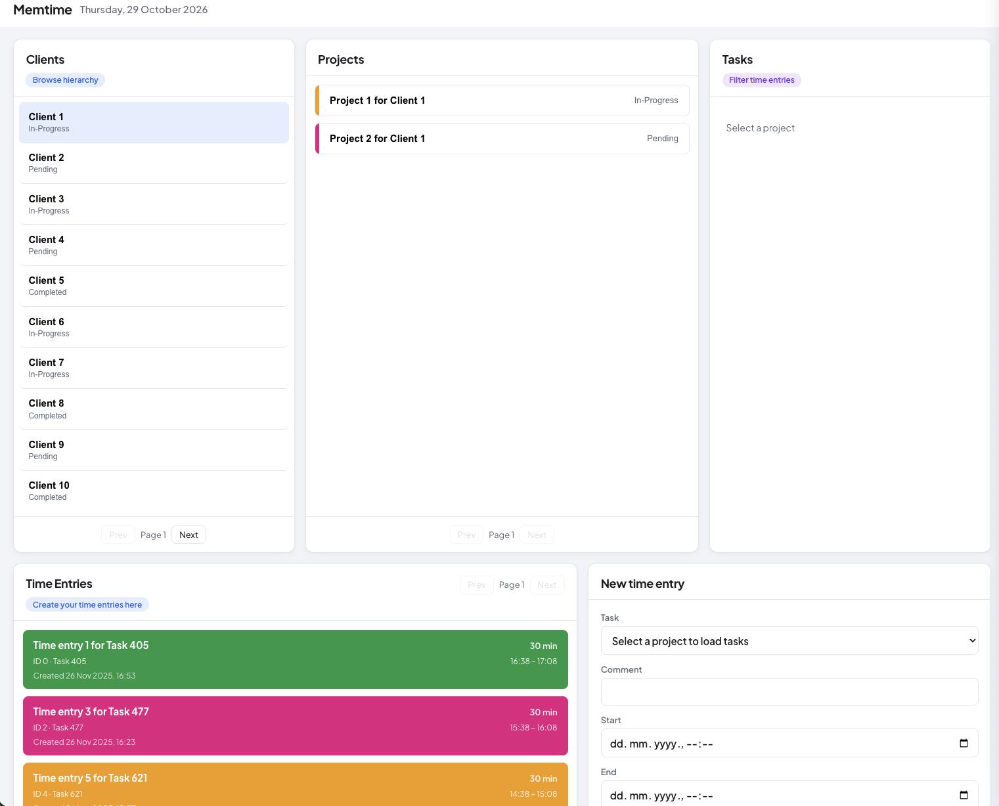

# Memtime Interview App

React + Vite + TypeScript client for the Memtime interview API: browse clients → projects → tasks, list time entries, and create/update entries.



## Setup

```bash
cp .env.example .env
# set VITE_API_KEY in .env

npm install
npm run dev
```

Open [http://localhost:5173](http://localhost:5173).

## Scripts

| Command | Description |
| --- | --- |
| `npm run dev` | Start Vite dev server |
| `npm run build` | Typecheck + production build |
| `npm test` | Run Vitest unit tests |
| `npm run lint` | Run Oxlint |

## Features

- Hierarchical clients / projects / tasks with pagination
- Time entries list (ID, task, comment, start–end, created at) with optional task filter
- Create and update time entries with validation + Sonner toasts
- Bearer auth via `VITE_API_KEY`

Selenium E2E tests live in `../Selenium Tests` (Java + Maven).
